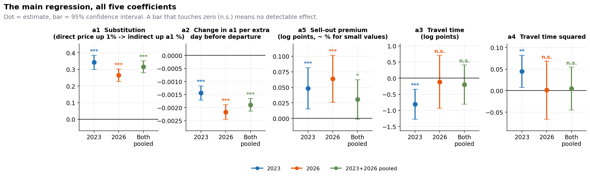
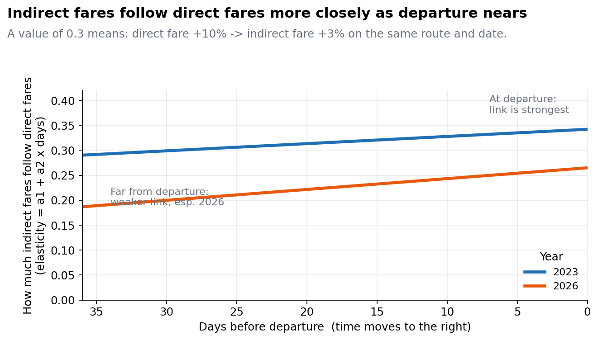
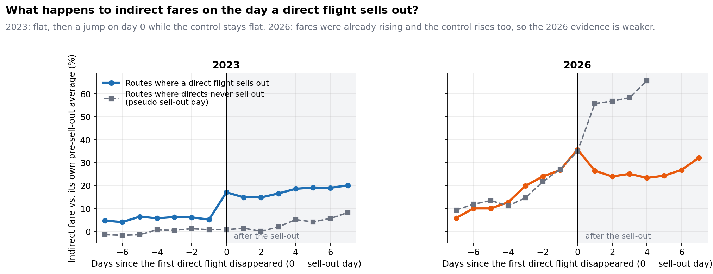

# Direct vs. Indirect Flight Pricing: Substitution and Scarcity

An empirical study of how the price of connecting flights moves with the price of direct flights on European short-haul routes, and what happens to indirect fares when direct flights sell out.

## Problem

Airlines reprice seats continuously as departure approaches. Direct flights are the quality benchmark, so they carry a premium. When direct inventory runs out, the demand that wanted a direct flight has to go somewhere, and connecting itineraries are the obvious fallback. Two questions follow:

1. **Substitution.** Do indirect prices track direct prices, and does that link change over the booking horizon?
2. **Scarcity.** Do indirect prices jump when direct flights disappear?

## Data

| | 2023 | 2026 |
|---|---|---|
| Source | Reference panel of scraped fares | Own daily scrape of a consumer booking platform |
| Departure dates | 15-21 April | 15-21 April |
| Booking horizon | 1-36 days before departure | 0-36 days before departure |
| Regression-ready rows (indirect) | 172,591 (128 routes) | 687,256 (121 routes) |

Raw data is not included in this repo (size, and the 2023 panel is not mine to redistribute). `data/sample/` holds tiny files that show the expected schemas.

## Model

Panel OLS on indirect itineraries, with route and departure-date fixed effects and standard errors clustered by route:

```
log(price_indirect) = a1 log(DirectPrice_avg)
                    + a2 log(DirectPrice_avg) x DaysBeforeDeparture
                    + a3 log(TravelTime) + a4 log(TravelTime)^2
                    + a5 SoldOutDummy
                    + route FE + departure-date FE (+ year FE when pooled)
```

`DirectPrice_avg` is the mean direct fare on the same route and departure date and day. `SoldOutDummy` is 1 once the number of direct flights on a route-date falls below its initial count. Details are in [docs/method.md](docs/method.md).

## Read this first

**[docs/FINDINGS.md](docs/FINDINGS.md)** is the full write-up: for each of the 4 core experiments, 7 extra questions and 6 robustness checks it gives the hypothesis, what was done, what was found, and a figure. It also lists what not to over-trust.

## Main results

From [results/results_merged.csv](results/results_merged.csv) (`***` p<0.01, `**` p<0.05, `*` p<0.1, blank = not significant):

| Coefficient | 2023 | 2026 | Pooled |
|---|---|---|---|
| a1 log(DirectPrice_avg) | 0.342 *** | 0.265 *** | 0.315 *** |
| a2 x DaysBeforeDeparture | -0.0014 *** | -0.0022 *** | -0.0019 *** |
| a3 log(TravelTime) | -0.811 *** | -0.114 | -0.198 |
| a4 log(TravelTime)^2 | 0.045 ** | 0.001 | 0.005 |
| a5 SoldOutDummy | 0.048 *** | 0.064 *** | 0.030 * |
| N | 172,591 | 687,256 | 859,847 |

- **Substitution holds in both years.** A 10% rise in the direct fare goes with a 2.6-3.4% rise in the indirect fare.
- **The link weakens as departure nears** (a2 < 0 in both years).
- **Sell-outs raise indirect fares.** In 2023 the event study shows a jump of about 11% on the day a direct flight first disappears, with a flat control group. In 2026 the pattern is much less clean (fares were already rising and the control rises too).
- **The travel-time discount** is U-shaped in 2023 and not detectable in 2026.
- **Price response is asymmetric** in 2023 (indirects follow directs up, not down); in 2026 they also follow downward moves, at roughly half the strength.





## Robustness

Six checks, run for both years (see [docs/experiments.md](docs/experiments.md)): first differences, a sell-out x direct-price interaction, an estimator comparison (FE vs RE, Hausman), residual diagnostics, direct-to-indirect Granger tests, and a placebo test that shuffles the sell-out dummy. The true a5 sits 21 (2023) and 29 (2026) standard deviations above the placebo mean.

Further questions covered: number of stops, sell-out intensity, low-cost-carrier share, quantile effects, sell-out timing, and the indirect-direct price gap.

## Layout

```
src/
  merge_scrapes.py        concatenate scraper outputs, dedupe, join LCC flag
  preprocess.py           clean, build DirectPrice_avg / SoldOutDummy / log terms
  regression.py           main regressions (2023, 2026, pooled)
  plots_2023.py           core figures
  causal_analysis.py      event study and LCC interaction
  additional_analysis.py  stops, intensity, asymmetry, quantiles, timing, gap
  robustness.py           the six robustness tests
  run_2026_analyses.py    everything above on the 2026 data
  run_merged_analyses.py  pooled 2023+2026 analysis with year effect
  summary_plots.py        summary figures from the results CSVs
  make_figures.py         clean write-up figures (results CSVs + a few typed-in numbers)
results/                  coefficient tables and event-study outputs
figures/clean/            the figures used in the write-up (regenerate with src/make_figures.py)
figures/                  2023/, 2026/, merged/, summary/: original script outputs, less polished
docs/FINDINGS.md          readable write-up of every question
docs/                     method, data overview, 2026 cleaning log, raw experiment log
data/sample/              schema examples
```

## Running

```bash
pip install -r requirements.txt
# put the raw files in data/ (paths are set at the top of each script), then from the repo root:
python src/preprocess.py --dataset merged
python src/regression.py --dataset merged
python src/summary_plots.py
```

Several analysis scripts read their input files from the working directory (`final_2023.csv`, `final_2026_fixed.csv`, `AMD.csv`); the constants at the top of each script say which.

## Notes

- 2026 raw data needed cleaning before use (price fields that captured schedule text, encoding of the euro sign, routes with no direct service); see [docs/data_cleaning_2026.md](docs/data_cleaning_2026.md).
- Results are for peak spring travel on European short-haul routes and may not carry over to other seasons.
- Observational data: the event study and placebo test support a causal reading of the sell-out effect, but common demand shocks are not fully ruled out.
- The quantile-regression question (cheap vs expensive tickets) is not answered: the output is implausibly identical across quantiles. See the caveats section of the findings.
