# Findings

Plain-language write-up of every question analysed in this repo, with the hypothesis, what was done, what was found, and the figure that shows it. The long raw log of runs is in [experiments.md](experiments.md); this page is the readable version.

**On hypotheses.** For the robustness checks (T1 to T6) the hypothesis was written down before the test, and it is quoted here. For the core experiments (Exp 1 to 4) and the extra questions (Q1 to Q7) no hypothesis was recorded at the time, so the "expectation" given below is the one that follows from the economic logic of the question.

---

## 1. Background in one minute

**The setting.** European short-haul routes, departures on 15-21 April, fares scraped over the weeks before departure. Two years: 2023 (172,591 indirect-fare observations, 128 routes) and 2026 (687,256 observations, 121 routes).

**Words used throughout**

| Term | Meaning |
|---|---|
| Direct / indirect | Non-stop flight / itinerary with 1 or more connections |
| Sell-out | A direct flight that was listed earlier on a route-date has disappeared from the listings |
| Route-date | One route on one departure date (for example AMS-CPH on 17 April) |
| Elasticity | "Direct fare up 10%, indirect fare up 3%" is an elasticity of 0.3 |
| Fixed effects | The model compares each route with itself and each date with itself, so "Paris is expensive" cannot masquerade as an effect |
| n.s. | Not statistically significant: the data cannot tell the effect from zero |
| LCC | Low-cost carrier |

**The model** (full detail in [method.md](method.md)). The log of the indirect fare is explained by:

- **a1**: the average direct fare on the same route-date and day (substitution)
- **a2**: that same direct fare times days-before-departure (does substitution change over the booking window?)
- **a3, a4**: travel time and its square (quality discount)
- **a5**: a sell-out dummy (scarcity premium)
- plus route and departure-date fixed effects, standard errors clustered by route.

---

## 2. The answers at a glance

| # | Question | 2023 | 2026 | Same story? |
|---|---|---|---|---|
| Exp 1 | Do indirect fares follow direct fares? | Yes: +10% direct -> +3.4% indirect | Yes: +2.6% | Yes, slightly weaker in 2026 |
| Exp 2 | Does that link change over the booking window? | Yes, weaker far from departure | Yes, and more so | Yes |
| Exp 3 | Do indirect fares jump when a direct sells out? | Yes, about +11% on the day | Unclear: fares were already rising and the control group rises too | Partly |
| Exp 4 | Is it different on low-cost routes? | No reliable difference | No reliable difference | Yes |
| Q1 | 1-stop vs 2-stop? | 2-stops follow directs less, pay more premium on sell-out | Same direction | Yes |
| Q2 | Partial vs full sell-out? | Dose-response: all directs gone = +22% | +27% | Yes |
| Q3 | Does LCC share matter? | No | No | Yes |
| Q4 | Same response to rising and falling directs? | No: follows up, not down | Follows up, and half-way down | Partly |
| Q5 | Cheap vs expensive tickets? | Result not trustworthy (see section 7) | Same problem | Not answered |
| Q6 | Which routes sell out early? | 47% of route-dates; LCC-heavy routes about 17 days earlier | 55%; later on average | Yes |
| Q7 | Does the fare gap widen toward departure? | EUR 18 -> 37 | EUR 55 -> 111 | Yes in euros; sell-out effect flips sign |
| T1-T6 | Robustness | All pass; Granger test only moderately supportive | All pass | Yes |
| Year effect | 2026 vs 2023 fares, everything else equal | | +27% to +38% | |

---

## 3. Core experiments

### Exp 1: Do indirect fares follow direct fares?

- **Expectation.** Yes. If connections are a substitute for non-stops, their price should rise when non-stop prices rise. a1 > 0.
- **What was done.** The main regression, full booking window (1-36 days), then repeated on a matched 1-11 day window.
- **What was found.**

| | 2023 | 2026 | Pooled |
|---|---|---|---|
| a1, full window | 0.342 *** | 0.265 *** | 0.315 *** |
| a1, 11-day window | 0.252 *** | 0.231 *** | |
| Model fit (R-squared) | 0.53 | 0.31 | 0.34 |

- **In plain words.** A 10% rise in the direct fare goes with a 2.6% to 3.4% rise in the indirect fare on the same route and date. The link is clearly there, and it is well below 1 because a connection is a worse product than a non-stop.

### Exp 2: Does the link change over the booking window?

- **Expectation.** Yes, a2 is different from zero. Nobody knew which way.
- **What was found.** a2 is negative in both years (-0.0014 in 2023, -0.0022 in 2026, both p < 0.001). Since the effect is a1 + a2 x days, it is **strongest at departure and weakest far away**. At 30 days out the elasticity is about 0.30 in 2023 and 0.20 in 2026; at departure both years are close to their a1.
- **In plain words.** Close to departure, indirect fares move almost in step with direct fares. Weeks out, they are more independent, especially in 2026.

### Exp 3: Do indirect fares jump when a direct flight sells out?

- **Expectation.** Yes. If displaced demand moves to connections, their fare should rise right when the direct flight disappears, and not before.
- **What was done.** Event study. For each route-date, the day a direct first disappears is day 0. Indirect fares are compared to that route-date's own average before day 0. 2023: 359 treated route-dates against 396 controls (directs never sold out). 2026: 417 against 334. Controls are given a pretend sell-out day (the median of the treated group).
- **What was found.**
  - **2023:** fares are flat before day 0, jump by about 0.10 log points (about +11%) on day 0, and stay up. The control group stays flat. This is the clean picture the design is meant to show.
  - **2026:** fares are higher on day 0 than a week earlier, and the post-minus-pre gap is about +10%. But fares were **already climbing for a week before day 0, and the control group climbs just as much**. So in 2026 the data do not separate a sell-out effect from the ordinary rise in fares near departure.
- **In plain words.** 2023 supports a scarcity jump. 2026 shows a similar-sized average step but a much weaker design, so I would not call it confirmation.

### Exp 4: Is the mechanism different on low-cost routes?

- **Expectation.** Possibly. Low-cost carriers price differently, so substitution and scarcity might differ.
- **What was done.** The main model plus two interaction terms: LCC x direct fare and LCC x sell-out.
- **What was found.** Neither interaction is significant in either year (p > 0.2). Point estimates differ, and in opposite directions in the two years: in 2023 the sell-out premium looks larger on LCC routes (0.09 vs 0.03), in 2026 smaller (0.04 vs 0.07). Only 11.6% of 2023 observations are LCC, so the test has little power. LCC indirect fares are about 46% cheaper at the same route and time (2023).
- **In plain words.** No evidence that low-cost routes work differently, but also not strong evidence that they do not.

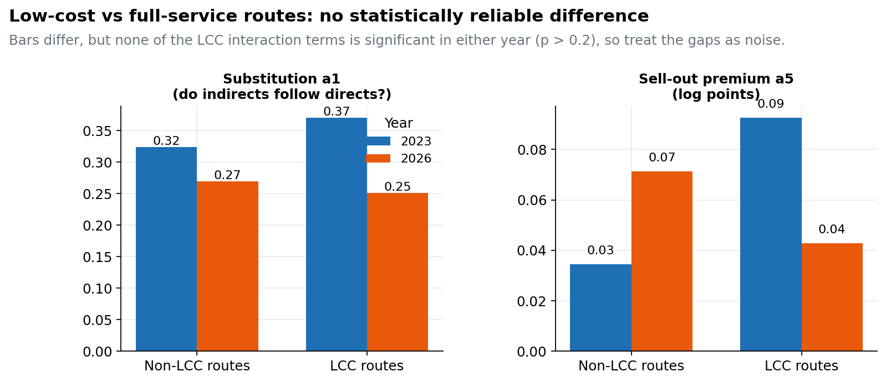

---

## 4. Extra questions

### Q1: 1-stop vs 2-stop itineraries

- **Expectation.** 2-stops are worse substitutes, so they should track directs less.
- **Found (2023).** Substitution a1 is 0.34 for 1-stop and 0.28 for 2-stop. The sell-out premium goes the other way: 0.04 for 1-stop and 0.14 for 2-stop (all significant, 9,280 two-stop observations). 2026 shows the same direction (a1 0.26 vs 0.15; 2-stop premium 0.08).
- **In plain words.** The worse the itinerary, the less it follows direct prices day to day, but the more it gains when directs vanish and travellers run out of better options.

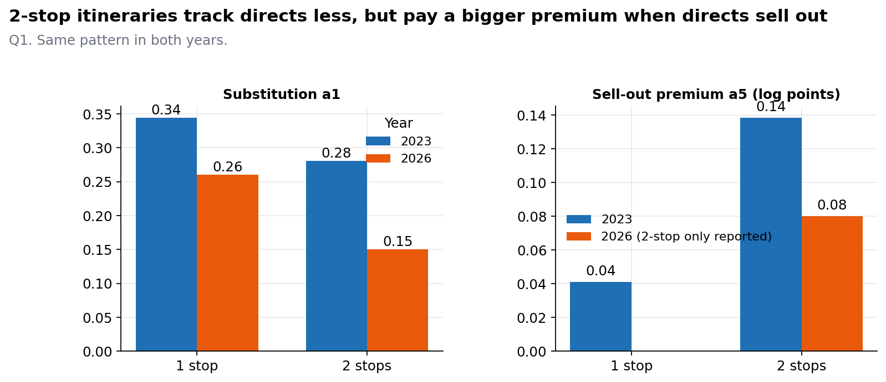

### Q2: Is a partial sell-out different from a full one?

- **Expectation.** More directs gone should mean a bigger premium.
- **What was done.** Replace the yes/no sell-out dummy with the share of a route-date's direct flights that have disappeared (0 to 1).
- **Found.** Coefficient 0.202 in 2023 and 0.238 in 2026 (both p < 0.001). Losing every direct implies about **+22% (2023) and +27% (2026)**. The yes/no dummy gives only about +5% to +7% because it treats losing one flight like losing all of them. In practice no route ever lost all of its directs.
- **In plain words.** Scarcity is a dose, not a switch.

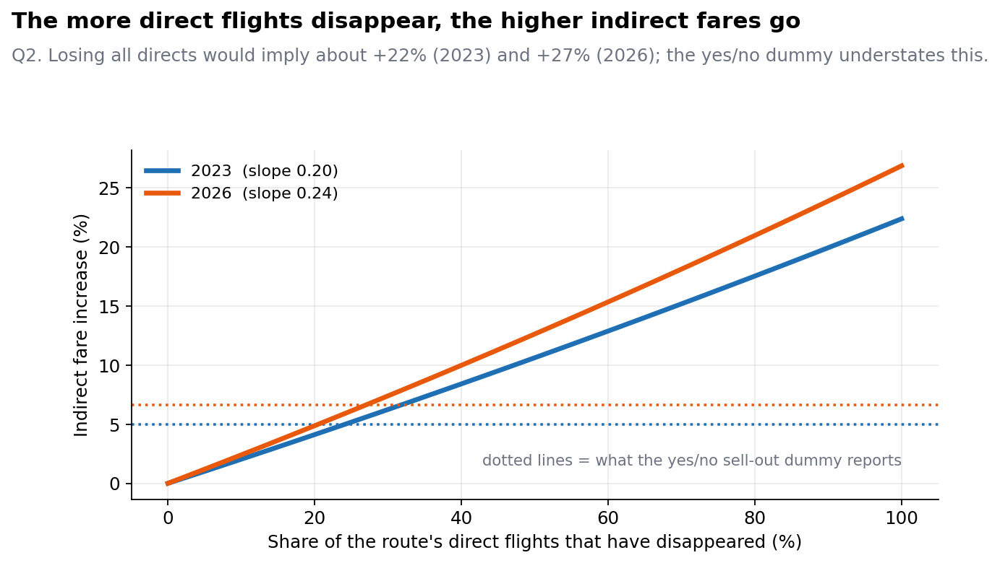

### Q3: Does the share of low-cost flights on a route matter?

- **Expectation.** A route with more LCC competition might respond differently.
- **Found (2023).** None of the three terms is significant (all p > 0.15). 2026 agrees.
- **In plain words.** The mechanism does not depend on how low-cost a route is.

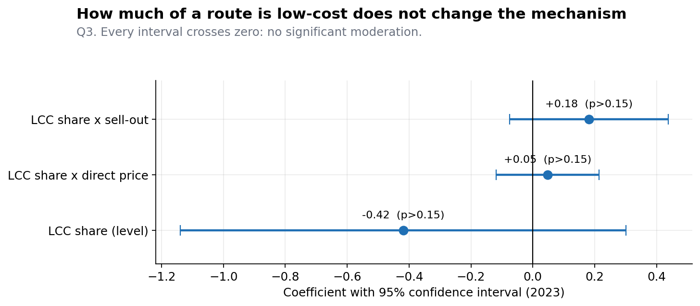

### Q4: Do indirect fares respond the same to direct fares going up and going down?

- **Expectation.** Possibly not. Carriers may follow price rises but ignore cuts.
- **What was done.** Split each direct fare's distance from its route-date average into an "above" part and a "below" part, with a separate coefficient on each.
- **Found.**

| | Response to directs above average | Response to directs below average |
|---|---|---|
| 2023 | 0.55 *** | 0.04 (n.s.) |
| 2026 | 0.74 | 0.35 |

The 2023 difference is significant (t = 5.4). In 2026 indirect fares do follow downward moves, at roughly half the strength.
- **In plain words.** Indirect fares are sticky downward: they rise with direct fares and come back down only partly or not at all.

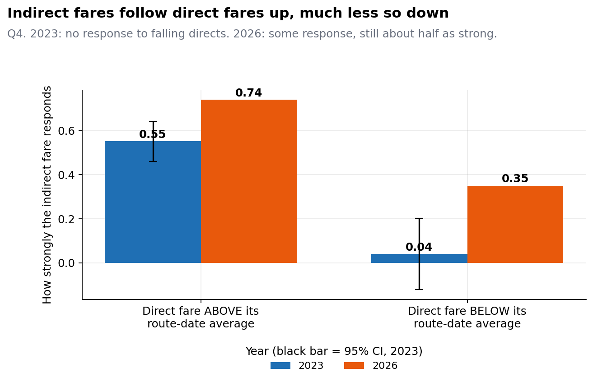

### Q5: Cheap vs expensive indirect tickets (quantile regression)

- **Expectation.** Expensive tickets might respond more.
- **Found.** The output shows identical coefficients at the 25th, 50th and 75th percentiles (0.2480 and 0.0697 to four decimals, in both years). **That is not a plausible result and I do not treat it as a finding**; see section 7. The question is open.

### Q6: Which routes sell out early?

- **Expectation.** Busier, more low-cost-heavy routes sell out earlier.
- **Found.** 47% of route-dates in 2023 see a direct disappear (55% in 2026). In 2023 the average is 22.7 days before departure; in 2026 it is 8.9. In the 2023 regression, LCC share is the strongest predictor (+17 days earlier for an all-LCC route, p < 0.001), followed by the number of direct flights (more flights, earlier sell-out, p = 0.003). The model explains only 12% of the variation, so timing is mostly route-specific luck.

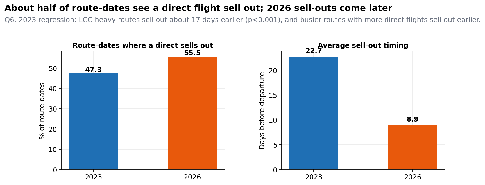
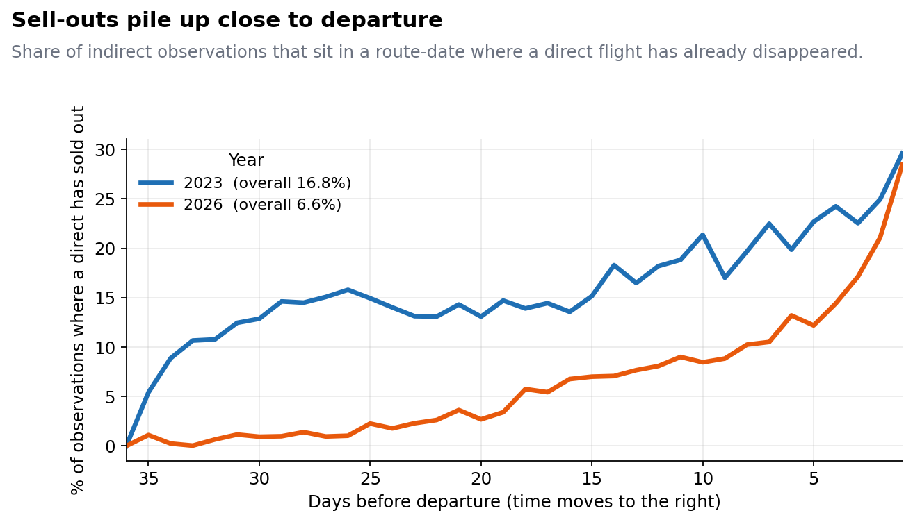

### Q7: Does the gap between indirect and direct fares widen toward departure?

- **Expectation.** Yes, as direct seats fill and prices rise.
- **Found.** The raw median gap grows from EUR 18 to 37 in 2023 and from EUR 55 to 111 in 2026. Inside a route-date, in proportional terms, the gap is slightly *larger* early, meaning direct fares rise faster proportionally near departure. A sell-out widens the gap by about 9.5% in 2023 but **narrows** it by about 7% in 2026.
- **Likely reason for the flip (my reading, not tested).** In 2026 the cheapest direct seats seem to go first, which pushes the average direct fare up and shrinks the gap.

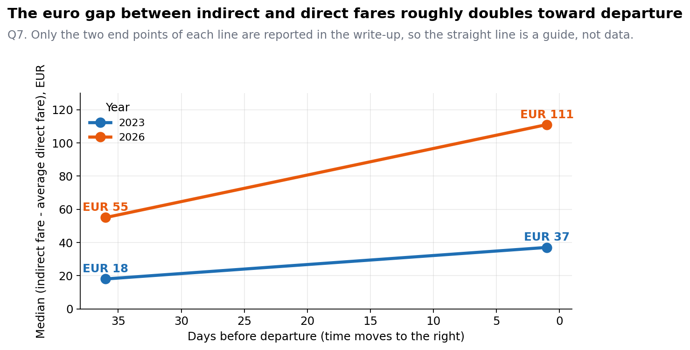

---

## 5. Robustness checks

| # | Hypothesis (as written beforehand) | Result | Verdict |
|---|---|---|---|
| T1 First differences | Effects should survive differencing, smaller but still significant | 2023: 0.063 and 0.017; 2026: 0.108 and 0.034; all p < 0.001 | Pass |
| T2 Sell-out x direct fare | Either elasticity drops when directs are gone, or the two effects are separate | Interaction is zero (p = 0.77 in 2023, 0.97 in 2026): additive | Effects are separate |
| T3 Fixed effects vs alternatives | Hausman test should reject random effects; a1 should be stable | Hausman p ~ 0; a1 stays 0.33 to 0.39; a5 flips negative without route fixed effects | Pass; route FE are required |
| T4 Residual diagnostics | Heteroskedasticity, high collinearity between travel time and its square, serial correlation all expected | All present (Breusch-Pagan p ~ 0; VIF 413 in 2023, 621 in 2026; lag-1 autocorrelation 0.49 and 0.41). Clustered errors already handle it | As expected |
| T5 Granger | Directs should lead indirects more often than the reverse | 35% vs 22% (2023), 46% vs 27% (2026) | Supportive, not conclusive |
| T6 Placebo | The true sell-out effect should sit far above shuffled-dummy runs | 21 sigma (2023), 29 sigma (2026), above all 100 shuffles | Pass |

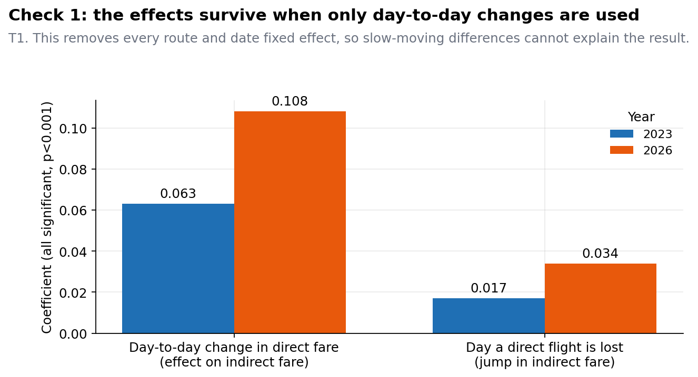
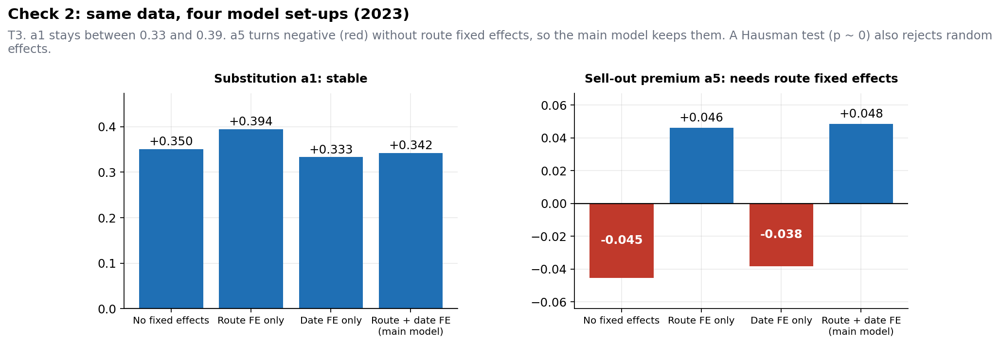
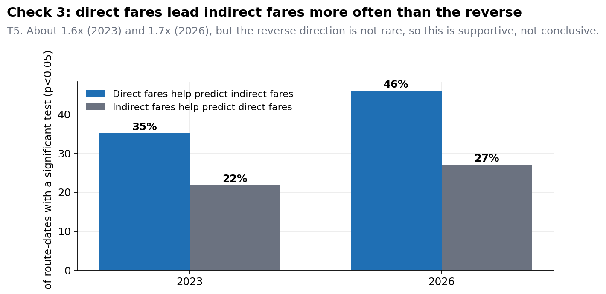
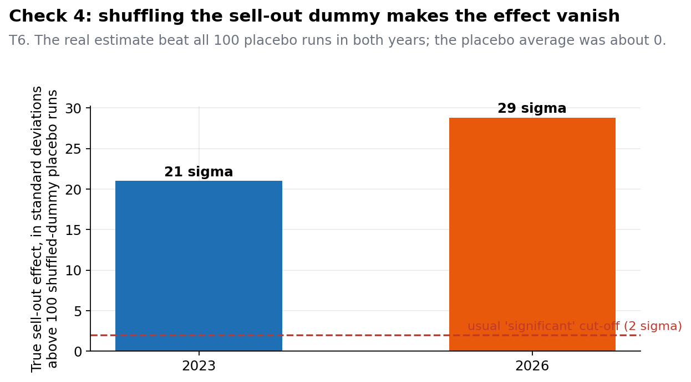

---

## 6. 2023 vs 2026 and the year effect

**What stayed the same:** substitution (a1 about 0.26 to 0.34), the fading link away from departure, the sell-out premium (positive, 5% to 7%), no LCC difference, additive structure, all robustness checks.

**What changed**

| | 2023 | 2026 |
|---|---|---|
| Substitution a1 | 0.34 | 0.26 |
| Link fades faster away from departure (a2) | -0.0014 | -0.0022 |
| Travel-time discount (a3, a4) | Present: -0.81, U-shaped | Gone: not significant, even with 4x the data |
| Sell-out premium a5 | 0.048 | 0.064 |
| Share of observations in a sold-out route-date | 16.8% | 6.6% |
| Response to falling directs (Q4) | None | About half as strong as rising |
| Sell-out effect on the euro gap (Q7) | Widens | Narrows |
| Median indirect / direct fare | EUR 220 / 188 | EUR 286 / 265 |

The disappearing travel-time effect is the biggest structural change. One possible reading is that in 2026 travel-time differences sit between routes rather than within them, where route fixed effects absorb them. That is an interpretation, not something I tested.

**Year effect.** With year fixed effects added, 2026 indirect fares are higher by 0.32 log points (about +38%) using all routes and the full window, or by 0.24 (about +27%) on the matched routes and the 11-day window. These are two specifications, not a contradiction. The conservative figure is +27%.

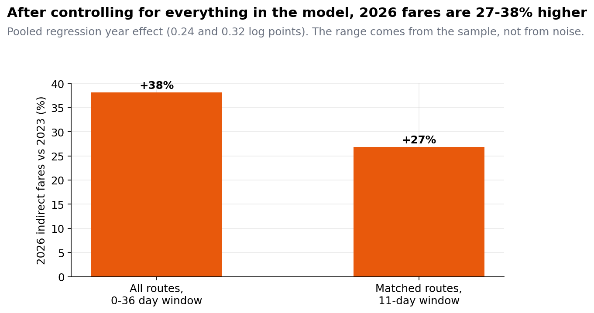
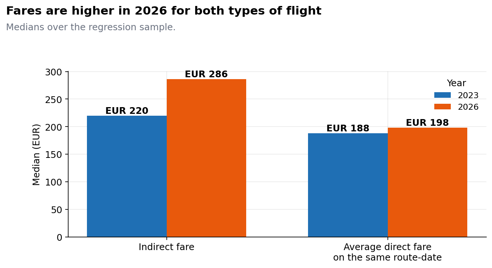
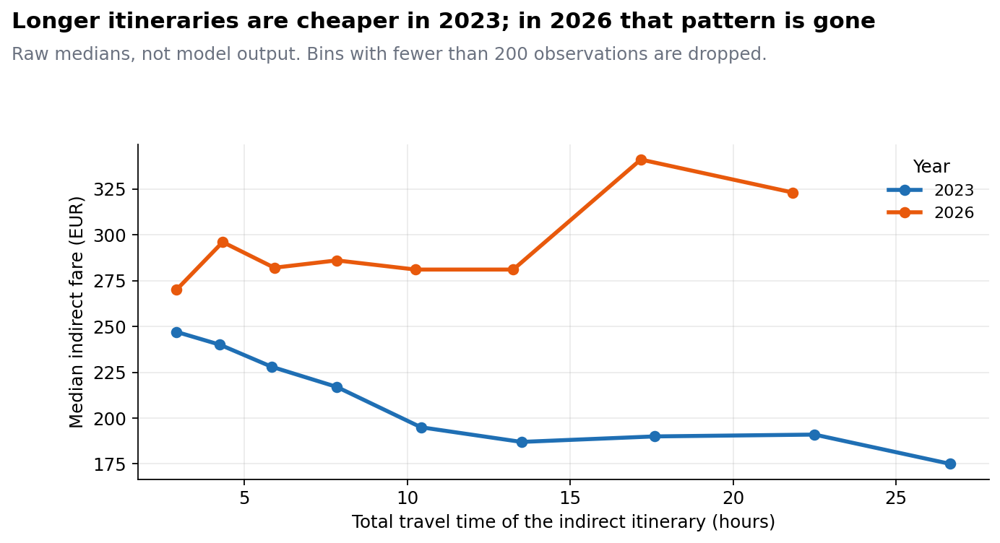

---

## 7. What to be careful about

1. **Q5 (quantile regression) is not a result.** Identical coefficients to four decimals at three quantiles, in two datasets, point to a computation issue, probably from the demeaning shortcut used to avoid fitting route dummies. Standard errors are also not clustered. It needs to be redone with proper fixed effects before saying anything about cheap vs expensive tickets.
2. **The 2026 event study is weak.** Fares rise before day 0 and the control group rises too. The statement in the original notes that 2026 is "virtually identical" to 2023 is stronger than the picture supports.
3. **Event-study size depends on the definition.** About +11% (2023) and +10% (2026) is the average post-sell-out level against the average pre-sell-out level. About +17% in both years is the single day-0 reading against the pre-event average. The merged-data run reports +17% and +36% with a different normalisation. Do not mix these.
4. **Observational data.** The event study, the placebo test and the Granger test make a causal reading plausible. A common demand shock that empties direct seats and lifts indirect fares at the same time is not ruled out.
5. **The two years are not like for like.** The booking-horizon coverage differed between the two scrapes (early planning notes expected only 1-11 days for 2026; the final 2026 file is documented as 0-36 days). The 11-day-window results in Exp 1 are the matched comparison.
6. **2026 has data-cleaning history.** Some scraped price fields captured schedule text, and many routes have no direct service to use as a benchmark; see [data_cleaning_2026.md](data_cleaning_2026.md).
7. **LCC results are low-power.** In 2023 only 11.6% of observations are low-cost. The 2026 LCC level coefficient is not identified (route fixed effects absorb it) and its huge standard error is a numerical artefact.
8. **Scope.** Peak spring travel, European short-haul, one departure week per year. Results may not carry over to other seasons or markets.
9. **Q7 looks contradictory but is not.** The euro gap grows toward departure because all fares rise; the proportional gap does not.
10. **Several Q and T figures use numbers typed in from the log** (see the top of `src/make_figures.py`), because those analyses did not write result tables. The Q7 line is drawn between two reported points, not through daily data.
